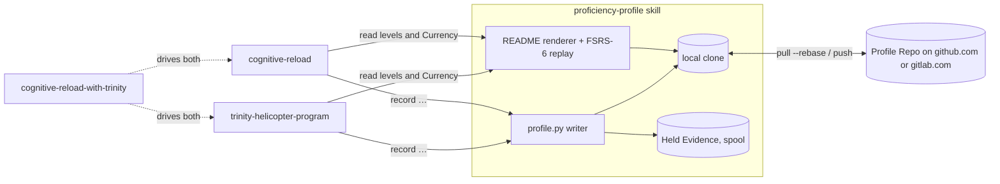

# Spec: the Proficiency Profile

Status: ready to build. Charted and decided on the map [Developer Proficiency Profile for the learning skills](https://github.com/TheMovingTargets/agent-skills/issues/14). Each section links the ticket that holds the reasoning; this spec gathers the outcomes and doesn't restate the debate. Terms are from [`GLOSSARY.md`](../../GLOSSARY.md).

## 1. What it is

Every developer has one **Proficiency Profile**. It lives in a private **Profile Repo** and is built only from **Evidence** that the learning skills record:
- Trinity Helicopter Program
- Cognitive Reload
- Cognitive Reload with Trinity

It measures two **Dimensions**, Language and Harness, each on **Proficiency** and **Currency**. **Area** and **Concept** are tags that cut across both.

The profile is **high-level only**. Nothing in the Profile Repo is more specific than a Dimension, Language, Area, Harness or Concept, so it never contains:
- repository names, paths, code or topics
- the learner's questions
- organization names, hostnames or work email addresses

Repository-specific detail stays in each skill's local store, and in each repository's own HITL Cognition Artifacts.



## 2. Evidence format

From [Research: xAPI statements as the Evidence format](https://github.com/TheMovingTargets/agent-skills/issues/15), with the privacy rules from [Grilling: what timestamps and Concepts could reveal](https://github.com/TheMovingTargets/agent-skills/issues/30).

Each piece of Evidence is one trimmed **xAPI 2.0 Statement** per line, in append-only JSON Lines. There's no LRS. Every line has its own id, so replaying the file into an LRS later is idempotent.

```json
{"id":"8d0c…(uuid4)","actor":{"objectType":"Agent","account":{"homePage":"https://github.com","name":"delhiryder"}},
 "verb":{"id":"https://w3id.org/xapi/devprof/verbs/practiced"},
 "object":{"objectType":"Activity","id":"https://w3id.org/xapi/devprof/concepts/csharp-dotnet/async.valuetask"},
 "result":{"success":true,"score":{"scaled":1.0}},
 "context":{"contextActivities":{"category":[{"id":"https://w3id.org/xapi/devprof/languages/csharp-dotnet"},{"id":"https://w3id.org/xapi/devprof/areas/backend"}]},
            "extensions":{"https://w3id.org/xapi/devprof/extensions/dimension":"language"}},
 "timestamp":"2026-11-05T00:00:00Z"}
```

**Fields that are kept:**

| Field | Contents |
|---|---|
| `id` | A random UUID v4, never time-based. |
| `actor` | An `account` for a Linked Identity (§5). |
| `verb` | One of the verbs in §3. |
| `object` | A Concept IRI, or a Harness IRI for `use`. |
| `result` | Only `success`, `completion` and `score.scaled`. |
| `context.contextActivities.category` | The Language, Harness and Area Activities. |
| `context.extensions` | One extension, the Dimension: `language` or `harness`. |
| `timestamp` | Midnight UTC on the day, for example `2026-11-05T00:00:00Z`. |

**Fields that are never written:**
- `stored`
- `context.language`
- parent, grouping or other contextActivities
- `platform`
- `registration`
- attachments
- `result.response`
- inline activity definitions

**Order within a day** is the line order. It decides which review is a day's first.

**Corrections** use a `voided` Statement that refers to the original line by its id. A void is only for a factually wrong line: a wrong Concept, a wrong person, or something recorded by mistake. A learner changing their mind is never a reason to void.

## 3. What the skills record

From [Grilling: what Evidence the skills emit](https://github.com/TheMovingTargets/agent-skills/issues/18) and its addendum from [Prototype: the Profile Repo README](https://github.com/TheMovingTargets/agent-skills/issues/22).

| Session event | Verb | FSRS review? | Grade and result |
|---|---|---|---|
| Trinity `skip` / "I know this" | none (ledger only) | — | — |
| Concept card shown | `experienced` (ADL) | no | — |
| Weeds rung 2 or deeper | `interacted` (ADL), one per Concept per day | no | — |
| `fly` drill, every attempt | `practiced` (`{ns}/verbs/practiced`) | yes, the first per Concept per day | Good: idiomatic, `score.scaled` 1.0. Hard: correct but not idiomatic, 0.5. Again: wrong, 0 with `success:false`. |
| Cognitive Reload teach-back | `passed`/`failed` (ADL) on each generic Concept it exercised. Dimension is `language`, tagged with the code's Language and, when obvious, the Area. | yes | `score.scaled` = area score / 5, and `passed` when the area score is 3.0 or above. Under 2.0 Again, 2.0–2.9 Hard, 3.0–3.9 Good, 4.0 and above Easy. |
| Cognitive Reload tutoring without assessment | none | — | — |
| A learning-skill session in a Harness | `use` (`http://activitystrea.ms/schema/1.0/use`). The object is the Harness Activity, Dimension `harness`, one per Harness per day. | yes, the Harness item only | Good |
| A Concept used unaided in real work | none in v1 | — | — |

**Area tags.** An Area is tagged only when the code's place in the stack is obvious. A missing Area is better than a wrong one.

**Architecture Concepts** have no Dimension of their own. They count under the Language they were taught back in.

## 4. Vocabularies

From [Grilling: the Concept and Area vocabularies](https://github.com/TheMovingTargets/agent-skills/issues/19), plus the proposal check from [Grilling: what timestamps and Concepts could reveal](https://github.com/TheMovingTargets/agent-skills/issues/30).

The namespace is `{ns}` = `https://w3id.org/xapi/devprof/`. The IRIs don't need to resolve, but registering the w3id redirect is a build task.

| Vocabulary | IRI | Seed | Lives in |
|---|---|---|---|
| Language | `{ns}languages/<pack-name>` | one per Trinity language pack (`csharp-dotnet`) | Trinity `references/languages/` |
| Language Concepts | `{ns}concepts/<pack-name>/<pack-id>`, scoped to their Language | the pack's ids, unchanged | Trinity `references/languages/<pack>.md` |
| Architecture Concepts | `{ns}concepts/arch/<id>` | the 18 ids listed below | Cognitive Reload `references/architecture-concepts.md` (new) |
| Areas | `{ns}areas/<id>` | `frontend` `backend` `data` `infrastructure` `mobile` `systems` `testing` `security` `tooling` `ai` | `proficiency-profile` `references/areas.md` |
| Harnesses | `{ns}harnesses/<id>` | `claude-code` `codex` | `proficiency-profile` `references/harnesses.md` |

The 18 seed architecture ids are:
- `layered-architecture`
- `hexagonal-ports`
- `dependency-injection`
- `repository-pattern`
- `cqrs`
- `event-sourcing`
- `pub-sub`
- `message-queue`
- `request-response-api`
- `rpc`
- `middleware-pipeline`
- `background-jobs`
- `state-machine`
- `plugin-architecture`
- `caching`
- `retry-backoff`
- `idempotency`
- `circuit-breaker`

**Format.** Every Vocabulary uses the language-pack table shape:
- ids are the first column, in backticks
- renames are `old.id → new.id` alias lines at the end of the file

Ids are forever.

**Matching topics to Concepts.** Cognitive Reload maps a repository topic only onto the architecture list, and the Trinity layer only onto pack ids. If nothing fits, nothing is recorded. Neither skill invents a Concept on the spot.

**Growth is by PR to this repo only, and unknown ids become Held Evidence:**

1. **Hold.** The writer rejects an id that isn't in the *installed* Vocabularies. It keeps the Statement, with its original timestamp, in the local held queue (§7), never in the Profile Repo.
2. **Check.** At the debrief, the skill lists the unknown ids. For each one, the developer confirms it names a public technology or pattern. It must also not be derived from the repository's own names, such as an internal framework, service or package. If either check fails, the held lines are discarded.
3. **Propose.** On a yes, the skill drafts the Vocabulary PR itself: a pack row, or an architecture, Area or Harness entry, in generic wording.
4. **Release.** At a later `session-start`, held lines whose id is now installed are released:
   - Aliased ids are rewritten to their target.
   - Each line goes into this machine's file for the month of its original timestamp.
   - Lines whose proposal was rejected are dropped.

A catalog that Trinity builds on the fly goes through the same steps. Saving the pack is the proposal.

## 5. Identity and Home Provider

From [Research: creating and pushing a private Profile Repo](https://github.com/TheMovingTargets/agent-skills/issues/17) and [Grilling: Azure DevOps as a Home Provider](https://github.com/TheMovingTargets/agent-skills/issues/24).

**Home Provider.** In v1 this is github.com or gitlab.com, or none: a **local-only profile** is a full, supported state. Azure DevOps, GitHub Enterprise and self-managed GitLab are only ever **Linked Identities**.

**Recording a Linked Identity:**

| Host | `account.homePage` | `account.name` | README header |
|---|---|---|---|
| github.com | `https://github.com` | login | GitHub · login |
| gitlab.com | `https://gitlab.com` | username | GitLab · username |
| Azure DevOps | `https://app.vssps.visualstudio.com` | the profile `id` GUID from `profiles/me` | Azure DevOps · display name |
| GitHub Enterprise or self-managed GitLab | `https://<host-type>.invalid` | login | host type · login |

None of them records an organization, a hostname or an email address.

**Choosing the actor.** It's the Linked Identity whose host matches the repo's remote (from `progress_store.py identity`). If none matches, it's the identity the Profile Repo was created under. An account that isn't linked yet gets a one-time offer to link it at the debrief.

## 6. Proficiency and Currency

From [Research: a Currency model for skills](https://github.com/TheMovingTargets/agent-skills/issues/16) and [Grilling: Proficiency levels and Currency display](https://github.com/TheMovingTargets/agent-skills/issues/20).

Proficiency is computed per Concept *within each Language*, using only the Evidence tagged with that Language. It's the highest level ever reached. Voided lines are ignored.

| Level | Earned by |
|---|---|
| **Introduced** | any `experienced`, or any retrieval, even a failed one |
| **Explored** | any `interacted` |
| **Practiced** | one retrieval graded Hard or better |
| **Proven** | Good or better on two days at least 7 days apart |

**Roll-ups:**
- **Language:** counts per level, with no single label.
- **Area:** counts per level plus Last Exercised, with no band.
- **Harness:** no level in v1. It shows its band, the number of days active, and its first and last use.

**Currency** comes from FSRS-6 retrievability R, using the 21 published default parameters, with no optimizer:
- Retrievals are replayed as reviews, at most one per item per UTC day (the first).
- The items are each Concept within a Language, each Language (the day's first retrieval in that Language), and each Harness.
- Stability is capped at 365 days after every update.
- The model version (`fsrs-6`, defaults, cap 365) is recorded wherever derived values are shown.
- Changing the model means deliberately replaying the log.

**Bands:**
- **Current:** R ≥ 0.9
- **Fading:** 0.7 ≤ R < 0.9
- **Lapsed:** R < 0.7

A band is always shown with its Last Exercised date and never as a percentage. An item with no retrieval yet shows "—". So does an Introduced Concept, even when a failed retrieval created its FSRS item; that failure still counts toward the Language's item.

## 7. The Profile Repo and the local stores

From [Grilling: writing to the Profile Repo](https://github.com/TheMovingTargets/agent-skills/issues/21), as revised by [Grilling: what timestamps and Concepts could reveal](https://github.com/TheMovingTargets/agent-skills/issues/30).

**The Profile Repo contains these files and nothing else:**

```text
README.md                                # generated, never hand-edited
profile.json                             # schema version, Linked Identities, Home Provider
evidence/<yyyy>/<mm>/<machine-id>.jsonl  # one file per machine per month
```

**Local locations:**

| What | Where |
|---|---|
| The clone, one per machine, shared by all the skills | `${XDG_DATA_HOME:-~/.local/share}/proficiency-profile/` |
| Machine id, lock, session state, held queue | `${XDG_STATE_HOME:-~/.local/state}/proficiency-profile/` |
| Excluded repos (hashes of remote URLs) | `${XDG_CONFIG_HOME:-~/.config}/proficiency-profile/excluded-repos` |
| Codex spool (§9) | `$TMPDIR/proficiency-profile-spool/` |

**Creation.**
- One approval creates both the local clone and the remote.
- The question is folded into the skill's first teaching message. It's never a turn of its own and never holds up teaching.
- If you decline, nothing is recorded, and the skill doesn't ask again unless prompted.
- Remotes are created private, with an explicit flag: `gh repo create --private` or `glab repo create --private`. The skill never runs a login.

**Writing.**
- Lines are appended at checkpoints, under the lock, as complete lines only.
- Each machine writes only its own files, so merges never conflict.
- A void goes into the current machine's current-month file.

**Commits.**
- There's one commit per session, with the generic message `Evidence: <n> lines (<yyyy-mm-dd>)`.
- The author and committer dates are midnight UTC on that day.
- The identity is the Home Provider's noreply address, set in the clone's own git config. A local-only profile uses a `<login>@localhost`-style address.
- Git runs with hooks disabled.

**Sync.**
- The writer runs `pull --rebase` then `push` at `session-start` and after the session commit.
- Offline, it skips them quietly.
- A rejected push means rebase and retry, never a force-push.
- The README is regenerated after every pull and on a rebase conflict.
- With no CLI or network, the profile stays local, and the debrief says so once.

**Local-only profile.** At most once per session, the debrief offers to add a remote, but only when a github.com or gitlab.com CLI is signed in.

## 8. The `proficiency-profile` skill and its interface

From [Grilling: integrating the profile into Trinity and Cognitive Reload](https://github.com/TheMovingTargets/agent-skills/issues/23).

**What the new skill owns:**
- `scripts/profile.py`, the writer and renderer, using only the standard library
- the Area and Harness Vocabularies
- these commands:
  - "show my profile", which prints the README summary
  - "link <account>"
  - "off the record"
  - "don't record in this repo"
  - "sync"

**How the other skills find it.** Trinity and Cognitive Reload use the sibling-skill search that Cognitive Reload with Trinity already uses:
- sibling folders
- `.agents/skills`, `.claude/skills`
- `~/.agents/skills`, `~/.claude/skills`, `~/.codex/skills`
- plugin caches

If it isn't found, they record nothing, say so once, and otherwise work as today.

**Packaging.** `install-local.sh` installs it alongside Cognitive Reload by default. Both `plugin.json` files list it.

```text
profile.py session-start --harness <id> [--repo <path>]
profile.py record experienced|interacted --lang <pack> --concept <id> [--area <id>]
profile.py record drill --lang <pack> --concept <id> --grade good|hard|again [--area <id>]
profile.py record teachback --lang <pack> --concepts <id,…> --score <0-5> [--area <id>]
profile.py session-end
profile.py read --lang <pack> [--concepts <id,…>]   # levels and Currency, for triage
profile.py off-the-record | exclude-repo | link <account> | sync | show
```

**What the writer owns.** The skills never build a Statement. The writer handles:
- turning events into verbs and grades
- the once-a-day deduplication
- the Vocabulary check and Held Evidence
- the actor
- the lock, session tagging and the commit

**`session-start`:**
1. Stop at once if the repo is excluded.
2. Merge any spool.
3. Commit lines left by an unfinished session as `Evidence: <n> lines (recovered)`.
4. Pull.
5. Release Held Evidence.
6. Write the day's Harness `use` line.
7. Report whether a Profile Repo exists.

**`session-end`** commits, pushes, and returns the single debrief line.

**"Off the record"** stops recording for the rest of the session and discards the session's uncommitted lines.

**During the session,** writing is silent. The only report is the one line at the debrief.

## 9. Codex

From [Research: Codex's sandbox and the Profile Repo](https://github.com/TheMovingTargets/agent-skills/issues/29).

Codex's default `workspace-write` sandbox can't write the clone, keeps `.git` read-only, and has no network. So the writer does this:
- **Detect** the sandbox from `CODEX_SANDBOX` or `CODEX_SANDBOX_NETWORK_DISABLED`, and from EPERM, EACCES or EROFS errors.
- **On a failed write:**
  1. Offer one escalated rerun.
  2. If that's declined, spool to `$TMPDIR/proficiency-profile-spool/`, never the workspace.
  3. Print the one-time config snippet. It adds the clone, `<clone>/.git` and Trinity's folder to `[sandbox_workspace_write] writable_roots`, using absolute paths. It adds `network_access = true` only if you want sync.
  4. Never fail the learning session.
- **Codex cloud** has no Profile Repo.
- **Before release,** check on a real Codex install that an explicit `.git` entry in `writable_roots` makes `git commit` work.

## 10. How the skills read and write the profile

From [Grilling: integrating the profile into Trinity and Cognitive Reload](https://github.com/TheMovingTargets/agent-skills/issues/23).

**Trinity Helicopter Program**
- **Session start:** `session-start`. The profile question goes next to the calibration question.
- **Recording:**
  - a card is `record experienced`
  - weeds rung 2 or deeper is `record interacted`
  - `fly` is `record drill`
  - `skip` writes only to the ledger
- **Calibration** ("which languages do you know") stays self-reported in the local ledger. Languages with Practiced or Proven Concepts in the profile also become bridge languages.
- **Triage** uses the stronger of the ledger status and the profile:
  - Proven and Current: silence
  - Practiced or Proven, but Fading or Lapsed: a one-line refresher
  - anything else: triage as today
- **Debrief:** the one next-step offer is a drill on this Language's top "Due for a refresh" Concept, when there is one. Then `session-end`.

**Cognitive Reload**
- **Orientation:** after `progress_store.py identity`/`get`, it calls `session-start`.
- **Tutoring** records nothing.
- **A scored teach-back** calls `record teachback` with the generic Concepts it exercised.
- **The pause** calls `session-end` after the progress save and before the publishing offer, and puts the one debrief line into the recap.
- **Reading the profile:** used only to pitch architecture explanations. Proven and Current means name the pattern and skip the primer; Lapsed means a brief refresher. It never skips repo-specific teaching and never affects scoring.

**Cognitive Reload with Trinity** calls `session-start` and `session-end` once each, not once per skill.

**Local stores.** Trinity's ledger and Cognitive Reload's progress store keep their current roles and aren't migrated. A new profile starts empty.

## 11. The generated README

From [Prototype: the Profile Repo README](https://github.com/TheMovingTargets/agent-skills/issues/22). The reference renderer is [`prototype/profile-readme`](https://github.com/TheMovingTargets/agent-skills/tree/prototype/profile-readme/prototypes/profile-readme), which is never merged.

In order:
1. **Header:** the developer and their Linked Identities, as recorded in §5.
2. **Summary** for each Language: a status line (counts per level, band, Last Exercised), then three lists:
   - **Solid:** Proven and Current
   - **Due for a refresh:** Practiced or Proven, but Fading or Lapsed
   - **In progress:** a count of Introduced and Explored Concepts
3. **Languages table:** counts per level, band and Last Exercised.
4. **Areas table:** counts per level and Last Exercised.
5. **Harnesses table:** days active, first used, band and Last Exercised.
6. **Concepts:** a collapsible table per Language (Concept, level, Currency), sorted by level.
7. **Legend and footer:**
   - the Evidence line count
   - "derived only from Evidence, never from self-claims"
   - FSRS-6 defaults with the 365-day cap
   - the generation date

## 12. Out of scope

All of these are listed on the map, with the reason for each:
- employer-hosted profiles
- team views
- signed credentials
- publishing a Public Profile Summary
- importing local ledgers
- Harness-feature Concepts
- unaided use as Evidence
- a single named Language level
- fitting FSRS parameters
- Dimensions beyond Language and Harness

## 13. Choices made while writing this spec

No ticket settled these details. They're the smallest choice that fits the decisions, so review them in the PR:

- **Extension and verb IRIs.** The Dimension extension is `{ns}extensions/dimension`, and the coined verb is `{ns}verbs/practiced`.
- **Local state lives outside the clone.** The lock, session state and held queue go in `$XDG_STATE_HOME/proficiency-profile/`, not in the clone, so the Profile Repo keeps its three-item layout and needs no `.gitignore`.
- **Account names on github.com and gitlab.com use the login.** The alternative is the numeric user id, which survives a rename but is unreadable.
- **The `record drill`, `record teachback` and `read` commands.** They take `--lang` so the Language scopes the Concept, and `read` was added as the triage lookup. Neither was spelled out in the integration ticket.
- **Self-hosted Linked Identities use `https://<host-type>.invalid` as their homePage,** so no hostname is recorded.

## 14. Build slices

Each slice is one build ticket, labelled `needs-triage`. "Blocked by" lists the slices it needs first.

| # | Slice | Delivers | Blocked by |
|---|---|---|---|
| 1 | Vocabularies | Cognitive Reload's `architecture-concepts.md`, and the Area and Harness lists in the new skill. A parser for pack-shaped tables and aliases, with tests. | — |
| 2 | Writer core, local-only | The `proficiency-profile` skeleton (SKILL.md, both plugin.json files, `install-local.sh`), Statement building and validation, the local clone, the lock, session tagging, `session-start`/`session-end`, rounded commits with hooks off, off the record, excluded repos, recovered commits. | 1 |
| 3 | Derivation and README | The FSRS-6 replay with the 365-day cap, levels, roll-ups, the README renderer, `read`, and "show my profile". The README prototype is the reference; tests use invented Evidence. | 2 |
| 4 | Remote Profile Repo and identities | Create on github.com or gitlab.com after one approval, noreply identity, pull/rebase/push and retry, README regenerated on conflict, Linked Identities and actor choice, the Azure DevOps and self-hosted recording rules, and the offer to add a remote. | 2 |
| 5 | Held Evidence | Hold, the public-id check, the drafted Vocabulary PR, and release with aliases. | 1, 2 |
| 6 | Codex support | Sandbox detection, the spool and its merge, the escalation offer and config snippet. Verify `.git` in `writable_roots` on a real install. | 2 |
| 7 | Trinity integration | SKILL.md hooks, recording, the calibration bridge languages, triage reading the profile, the refresh-drill offer. | 3 |
| 8 | Cognitive Reload integration | Orientation and pause hooks, teach-back recording, architecture pitch. | 3 |
| 9 | Cognitive Reload with Trinity | One `session-start` and one `session-end` across both skills, plus the profile question folded into orientation. | 7, 8 |
| 10 | Register the w3id namespace | A PR to `perma-id/w3id.org` for `/xapi/devprof/`. This one is for a human. | — |
